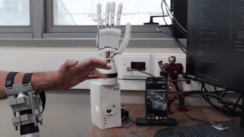

# SonoRank: Towards Calibration-Free Real-Time Finger Flexion Detection from Forearm Ultrasound Sequences

Official code repository for the paper accepted to the **2026 IEEE/RSJ International Conference on Intelligent Robots and Systems (IROS)**.

Paper: [arXiv:2607.07542](https://arxiv.org/abs/2607.07542)



*A demo showing SonoRank detecting individual finger flex events in real time from forearm ultrasound, connected to a robotic hand that mirrors the detected motion.*

### Dataset

The SonoRank data and download instructions are available in [DATASET.md](DATASET.md).

### System Requirements

* Operating system: Ubuntu 18.04 or newer
* GPU: NVIDIA RTX 3080 or newer recommended
* RAM: 32 GB recommended

### Installation

The project uses Python 3.9 and PyTorch 2.0. Dependencies are listed in `requirements.txt`. One way to create the environment is:

1. Install [Anaconda](https://www.anaconda.com/products/individual/).

2. Create and activate the environment:

```bash
conda create -n sonorank python=3.9 anaconda
conda activate sonorank
pip install -r requirements.txt
```

### Overview

SonoRank first learns to rank pairs of ultrasound sequences by relative motion magnitude for each finger. The learned representation is then fine-tuned to classify finger flexion using a rest reference captured at startup.

The paper evaluates three model variants and four external baselines. The table below maps each paper name to its code implementation:

| Paper name | Description | Code class | Training script | Key flags |
|------------|-------------|------------|-----------------|-----------|
| **SonoRank** | Full pipeline: ranking pretraining + classification with rest reference | `FlexEmbeddingClassifier` | `train_flex_embedding.py` | *(default)* |
| **MFT+Rest** | No ranking pretraining, classification with rest reference | `FlexEmbeddingClassifier` | `train_flex_embedding.py` | `--encoder-only` |
| **MFT** | No ranking pretraining, no rest reference | `FlexEmbeddingClassifier` | `train_flex_embedding.py` | `--encoder-only --no-rest` |
| CBMF | Zadok et al. 2025 | `CBMFModel` | `train_cbmf.py` | |
| BimbrawVGG | Bimbraw et al. 2023 | `BimbrawVGG` | `train_bimbraw.py` | |
| Castellini | Castellini & Passig 2011 | sklearn pipeline | `train_classic_baselines.py` | `--method castellini` |
| Huang | Huang & Liu 2016 | sklearn pipeline | `train_classic_baselines.py` | `--method huang` |
| McIntosh | McIntosh et al. 2017 (EchoFlex) | sklearn pipeline | `train_classic_baselines.py` | `--method mcintosh` |

The model definitions are in `trainer/model.py`. The core backbone is `MultiFingerTemporalRankingModel` (frame encoder + temporal transformer + 5 parallel comparison heads). `FlexEmbeddingClassifier` wraps this backbone and replaces the comparison heads with a classification MLP.

**Training**

Training has three levels. Each level uses the checkpoint produced by the previous one.

> **Before running a launcher:** update `PYTHON_BIN`, `SELECTED_TEST_SUBJECTS`,
> and `GPU_IDS` for your machine. The checked-in values reproduce individual
> batches from the original experiments, so some scripts contain only part of
> the twelve-fold run.
>
> Some Python entry points also retain the author's original default input
> paths. Pass `--data-dir data/processed_h5/h5_files` when invoking a trainer
> directly, or add that argument to the selected launcher.

```
Level 1: Encoder pretraining (EmbeddingAutoencoder)
  ./scripts/run_cross_subject_embedding.sh

Level 2: Multi-finger ranking (MultiFingerTemporalRankingModel)
  ./scripts/run_cross_subject_multi_finger_ranking.sh

Level 3: Flex classification (FlexEmbeddingClassifier to SonoRank)
  ./scripts/run_cross_subject_flex_embedding.sh
```

The scripts support 12-fold leave-one-subject-out validation and can distribute folds across several GPUs. See [scripts/README.md](scripts/README.md) before running them.

To train the **MFT** or **MFT+Rest** ablation baselines, edit `run_cross_subject_flex_embedding.sh` and change the model variant flags:
```bash
# SonoRank (default):  ENCODER_ONLY=false  NO_REST=false
# MFT+Rest ablation:   ENCODER_ONLY=true   NO_REST=false
# MFT ablation:        ENCODER_ONLY=true   NO_REST=true
```

The baseline launchers do not depend on the three training levels:
```
./scripts/run_cross_subject_cbmf.sh
./scripts/run_cross_subject_bimbraw.sh
./scripts/run_cross_subject_classic_baselines.sh
```

**Evaluation**

Compare methods from their saved fold predictions:

```
python -m evaluation.evaluate_methods_fair --methods-dir outputs/experiments/methods_fixed_labels
```

Event-level evaluation for individual checkpoints:

```
python -m evaluation.evaluate_flex_embedding_events --checkpoint path/to/checkpoint_best.pth --gpu-id 0
```

**Ablation studies**

Sequence length, training set size, and uncertainty weight sweeps:

```
./scripts/sweep_sequence_length.sh
./scripts/sweep_subject_count.sh
./scripts/sweep_uncertainty_weight.sh
```

### Real-time Implementation

The code in `sonorank_realtime` connects to a Clarius ultrasound probe and predicts finger flexion from the incoming stream. It can also send the detected motion to a robotic hand over serial. Setup instructions are in [sonorank_realtime/README.md](sonorank_realtime/README.md).

### Citing

If this repository helped your research, please consider citing:
```
@inproceedings{zadok2026sonorank,
  title         = {SonoRank: Towards Calibration-Free Real-Time Finger Flexion Detection from Forearm Ultrasound Sequences},
  author        = {Zadok, Dean and Wolf, Alon and Bronstein, Alex M. and Salzman, Oren},
  booktitle     = {2026 IEEE/RSJ International Conference on Intelligent Robots and Systems (IROS)},
  year          = {2026},
  eprint        = {2607.07542},
  archivePrefix = {arXiv},
  primaryClass  = {cs.RO}
}
```

### Acknowledgments

We thank [Haifa3D](https://www.haifa3d.com/), a non-profit organization providing self-made 3D-printed assistive solutions, for their support throughout this research. We also thank the subjects who participated in the creation of the dataset.

This work was supported by the David Himelberg Foundation, the Wynn Family Foundation, and the Israeli Ministry of Science & Technology grant no. 8774.

### Contact

For questions or issues, please open a GitHub issue or contact Dean Zadok at [deanzadok@cs.technion.ac.il](mailto:deanzadok@cs.technion.ac.il).

### License

The code uses the MIT License. See [LICENSE](LICENSE). Dataset information is provided separately in [DATASET.md](DATASET.md).
